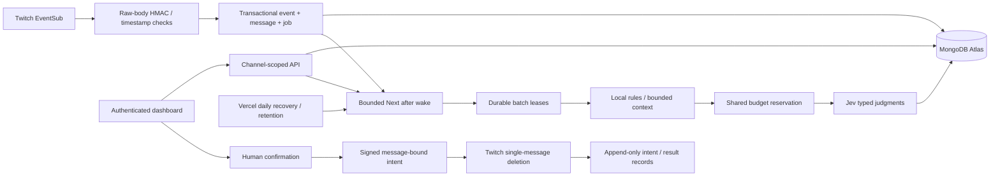

# Architecture

## Code boundaries

`src/components`: approved visual workspace, charts and Radix/shadcn-style primitives. `src/types`: shared domain/database contracts. `src/lib/moderation`: pure deterministic signals and review-risk policy. `src/lib/ai`: verified request/response contract, injected transport, server client and durable processing. `src/lib/twitch`: OAuth/token/Helix and webhook signature logic. `src/lib/auth`: cryptography, session/membership and message-bound confirmation. `src/lib/database`: server-only native MongoDB client and query mapping. Route handlers validate and orchestrate; they do not render UI.

## Data and identity

Broadcaster-only MVP. Twitch identity maps to app_users and channel_members. Session token is random, stored only hashed in app_sessions; access/refresh tokens are AES-256-GCM encrypted in oauth_tokens. App cookies are HttpOnly, SameSite=Lax and Secure in production. Frontend never receives Twitch/TypeSafe/service-role secrets.

Server APIs use a database account restricted to the crowdplay database. The browser receives no MongoDB connection string or database access. Server sessions and owner-membership predicates establish authorization; all message/history/settings/audit queries are channel-qualified. MongoDB does not provide PostgreSQL RLS, and no Supabase Auth JWT is minted. The custom Twitch cookie/session design is unchanged.

The native MongoDB pool is shared across warm requests and development reloads. Default pool size is five with finite connection/socket timeouts. MongoDB documents use stable UUID strings for application identity and BSON Date values for expiry/lease fields. Collections and unique/TTL indexes initialize idempotently before transactions.

## Ingestion and processing

Signed chat intake commits a unique webhook event, unique channel/message and durable job in one MongoDB transaction. It acknowledges durable storage before AI. Classifications/signals are embedded in their message document; viewer aggregates derive from the loaded message window. Jobs become eligible after 800 ms. Atomic findOneAndUpdate claims at most the configured batch size using unique lease tokens, attempt limits and 90-second expiry. Completion/pause/failure uses transactions with the same token predicate, so an old worker cannot overwrite a new lease. Vercel processing remains bounded to 60 seconds.

An ingress after() wake, an active authenticated dashboard wake (at most once per ten seconds per channel), explicit classify POST or daily cron can resume work. Failure retries use available_at backoff and at most five attempts. Expired leases are reclaimable; exhausted leases become visible failed messages. after() is a wake mechanism, not the durable queue. Idle-channel retry can wait until the daily cron when neither messages nor an open dashboard are present. This avoids requiring a paid high-frequency cron, but is not a high-throughput scheduling guarantee.

No dedicated persistent server or WebSocket connection is required. Higher-volume production use should move the wake/recovery mechanism to a verified durable queue/workflow with throughput/load tests; it must preserve the same database idempotency and human-action boundaries.

Local signals are computed over at most 200 loaded historical messages per batch. At extreme chat volume this can miss longer repetition windows; this bounded context limitation must not be mistaken for complete viewer surveillance. The model sees up to 12 previous messages, pseudonymous author fields and 500 characters per message, with full original text retained in the database. Payloads exceeding the byte budget pause instead of silently truncating the entire request.

## Decisions, caching and money

Choice distributions and Noul values are validated before storage. Application policy turns probabilities, confidence and local signals into review priority; no policy can invoke moderation. Filtering is pure local computation. Cache binds exact channel/model/rules/messages/context; one-hour expiry and no raw context in cache keys.

MongoDB reservation transactions first write the shared channel settings document, serializing concurrent budget checks and reservation inserts. Failures with uncertain billing retain reservations; actual usage settles known outcomes. Unknown usage or underestimated charges disable AI pending investigation. Values are price-based estimates; they cannot guarantee a provider financial cap without an independently verified token/cost bound and account-level spending controls.

## Dashboard updates and retention

The dashboard uses authenticated polling every three seconds. Channel authorization is checked on each request. Polling suspends on hidden tabs and retains the last snapshot on error. Reads return at most 500 latest messages and 100 actions; analytics explicitly describe this window. Full historical pagination and team moderation are deferred.

BSON expiry dates and TTL indexes expire messages, jobs, caches, audit notes, usage/events, sessions and rate-limit windows. Classifications are embedded in messages and expire with them. Reads reject expired records immediately; the daily cron also enforces shortened channel retention for messages/jobs/audit notes. Message/history reads respect a newly shortened retention window. TTL/background cleanup is eventual, not an exact erasure SLA. Channel/account configuration remains until an explicit future account-erasure flow.

The old SQL migration and test scripts are archived under docs/archive/postgres, not used by the runtime. MongoDB transactions require a replica set/Atlas deployment, not an unsupported standalone local server. See [official driver transactions](https://www.mongodb.com/docs/drivers/node/current/crud/transactions/) and [client reuse](https://www.mongodb.com/docs/drivers/node/current/connect/mongoclient/). Live transaction behaviour has not yet been verified in this environment.
